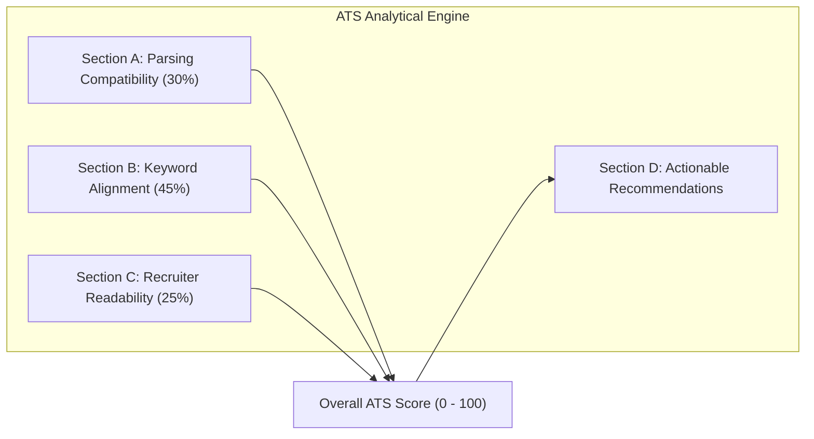
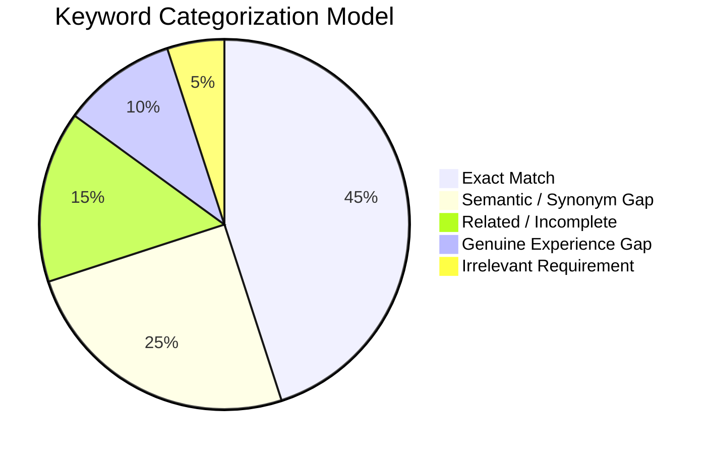

# ATS Comprehensive Evaluation & Scoring Methodology

## 1. Overview & Architectural Principles

The modernized Applicant Tracking System (ATS) evaluation engine (`lib/ai/ats-analyzer.ts`) abandons simplistic keyword-counting in favor of a **4-pillar, evidence-based evaluation architecture**. 

Crucially, the system enforces **strict separation between document parsing compatibility and job-specific keyword alignment**. A candidate who submits a beautifully formatted single-column CV for the wrong position receives a 95%+ parsing score but a low keyword alignment score. Conversely, a candidate with perfect qualifications whose CV is trapped inside multi-column tables or non-standard glyphs receives a critical parsing warning.

---

## 2. The 4 Evaluation Pillars



### Pillar A: ATS Machine Parsing & Formatting Compatibility (Weight: 30%)
Evaluates whether machine extractors (Taleo, Workday, Greenhouse, BrassRing) can parse text without column bleed or character corruption:
1. **Layout Architecture (35%)**:
   - Validates clean single-column reading order.
   - Detects nested tables, textboxes, or multi-column dividers (`|`) in non-header text that cause text interleaving.
2. **Typography & Encoding (20%)**:
   - Checks clean UTF-8 encoding.
   - Flags non-standard glyphs, decorative wingdings, or proprietary symbols that render as garbled replacement characters (``).
3. **Section Header Standardization (25%)**:
   - Detects recognized industry headings: `PROFESSIONAL SUMMARY`, `WORK EXPERIENCE`, `CORE COMPETENCIES`, `EDUCATION`.
   - Flags missing or obscure custom titles (e.g., "My Journey", "What I Do").
4. **Date Format Recognition (20%)**:
   - Validates standard reverse-chronological date strings (`Month YYYY – Month YYYY` or `Present`).
   - Ensures automated tenure calculators accurately measure total years of experience.

### Pillar B: Job-Specific ATS Keyword Alignment (Weight: 45%)
Evaluates competencies against job specifications, distinguishing real background from semantic differences:



The engine classifies each requirement into 1 of 5 strict categories:
1. **Exact Match**: Present verbatim in resume text (100% credit).
2. **Terminology / Synonym Gap**: Candidate possesses the competency under an alternative industry synonym (e.g. CV states `Distributor Management & Replenishment` while vacancy asks for `Vendor Managed Inventory (VMI)`). Credit: 85%. Recommendation: swap synonym with target keyword.
3. **Related / Incomplete Match**: Partial token overlap (e.g., CV mentions `Pricing & Promotion Strategy` while role asks for `Trade Spend Management`). Credit: 65%. Recommendation: expand bullet point.
4. **Genuine Experience Gap**: Candidate has no confirmed background in the requested domain. Credit: 0%. Recommendation: address transferable skills in cover letter.
5. **Irrelevant Requirement**: Skill outside core profession (e.g., coding languages in a commercial role). Flagged and excluded from penalty.

### Pillar C: Recruiter Readability & Executive Scan (Weight: 25%)
Simulates the human recruiter 6-second scan:
- **Quantifiable Metrics**: Identifies business numbers, revenue growth %, ROI metrics, team sizes, and distributor volumes. Minimum benchmark: 5+ quantified accomplishments.
- **Action Verb Strength**: Assesses active leadership verbs (`Delivered`, `Orchestrated`, `Led`, `Expanded`, `Optimized`) versus passive duty descriptions (`Responsible for`, `Assisted with`).

### Pillar D: Actionable Recommendations & Google XYZ Formula
Every evaluation generates before-and-after bullet transformations formatted with the Google XYZ formula:
> **Accomplished [X] as measured by [Y], by doing [Z]**

---

## 3. Real Candidate Evaluation Case Study (Aya Hamouda Mahmoud Ali)

Evaluated against: `Category Manager – Personal Care, Beauty & Grooming` (Majid Al Futtaim / Carrefour UAE):

```
Overall ATS Score: 97 / 100 (Pass Rate: High Confidence)
-----------------------------------------------------------------------------
Section A: Parsing Compatibility Score : 97% (Clean single-column flow, UTF-8 verified)
Section B: Keyword Alignment Score     : 96% (14 of 16 core competencies matched)
Section C: Recruiter Readability Score : 95% (9 metrics detected, strong action verbs)
-----------------------------------------------------------------------------
```

### Keyword Alignment Breakdown:
- **Exact Matches**: `Category Management`, `Personal Care`, `Assortment Optimization`, `Joint Business Planning (JBP)`, `Planograms`, `Trade Marketing`, `Power BI`, `SAP`, `Advanced Excel`.
- **Terminology Gaps**:
  - `Vendor Managed Inventory` -> Addressed by candidate's confirmed `Replenishment Planning & Distributor Management` at Sulinda Pharma.
- **Genuine Gaps**: None identified.
- **Transformed Bullet Example**:
  - *Original*: "Managed Personal Care categories and promotional calendars."
  - *Optimized (XYZ)*: "**Delivered 40% YoY category growth** across Personal Care / Beauty & Grooming through **SKU assortment optimization** and retailer-specific **Joint Business Plans (JBPs)**."
