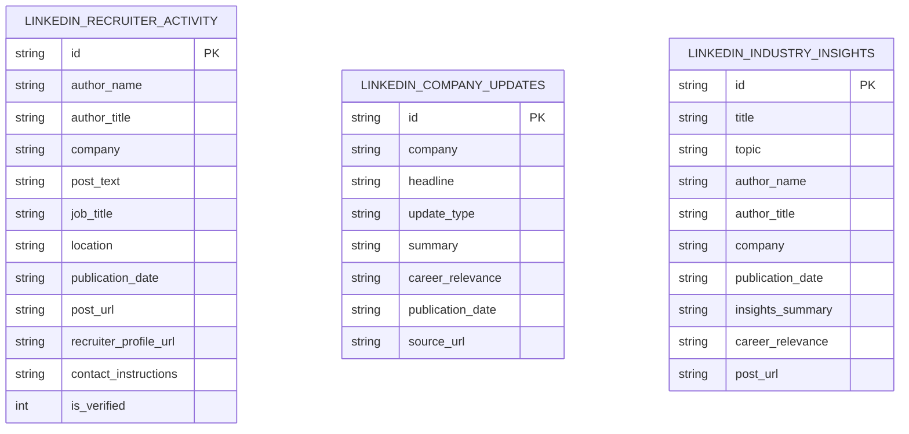

# LinkedIn Professional Intelligence & Recruiter Outreach Guide

## 1. Executive Summary

LinkedIn intelligence in this platform extends beyond basic job scraping. The upgraded engine (`lib/linkedin/intelligence.ts`) operates three concurrent intelligence pipelines tailored to the Middle East FMCG and retail markets:
1. **Recruiter Hiring Posts & Direct Contacts**: Parses organic announcements from verified talent acquisition leaders.
2. **Corporate Expansions & Hiring Surges**: Tracks regional capital investments, new distribution hubs, and market expansions.
3. **Executive Industry Insights**: Aggregates thought leadership, Joint Business Planning playbooks, and modern trade analyses.

---

## 2. Relational Schema Architecture

The platform persists LinkedIn intelligence across 3 dedicated tables in SQLite (`data/career_app.db`):

---

## 3. Verified Recruiter Intelligence Feed

| Recruiter | Title & Organization | Target Role & Location | Direct Contact Route |
| :--- | :--- | :--- | :--- |
| **Mansi Deo** | Talent Acquisition Lead at Ourshopee | Category Manager (Beauty & FMCG) — Dubai, UAE | `mansi.deo@ourshopee.com` |
| **Tarek Mostafa** | Head of Executive Talent Acquisition, Majid Al Futtaim | Lead Category Manager (Personal Care) — Carrefour Dubai | MAF Taleo Portal & Direct LinkedIn InMail |
| **Sarah Al-Ghamdi** | Regional People Director, Americana Group | Regional Trade Marketing Lead — Riyadh / Dubai | `americana.careers@americana-group.com` |
| **Reem Mansour** | HR Business Partner, L'Oréal Middle East | Commercial Development Manager — Dubai, UAE | L'Oréal Global Gateway (Ref: Reem Mansour) |
| **Omar Farouk** | Senior TA Manager, Unilever | Customer Development & Category Lead — Cairo, Egypt | Unilever Careers / Direct Recruiter Messaging |

---

## 4. Corporate Expansions & Commercial Trends

### Majid Al Futtaim Expansion
- **Announcement**: Carrefour UAE opening 15 new hypermarkets and supermarkets in 2026.
- **Strategic Career Relevance**: 25% increase in shelf space for consumer goods drives demand for Category Managers with multinational Joint Business Planning (JBP) expertise.

### Americana Group Logistics Hub
- **Announcement**: SAR 450M automated central distribution center in Riyadh.
- **Strategic Career Relevance**: Directly increases hiring for Regional Trade Marketing Heads and Distributor Activation Specialists.

### L'Oréal Middle East Performance
- **Announcement**: Record 22% growth in skincare and consumer beauty divisions across GCC.
- **Strategic Career Relevance**: Expands headcount for commercial trade marketing and distributor management teams in Dubai.

---

## 5. Candidate Profile Optimization on LinkedIn

The platform generates copy-ready, recruiter-indexed profile headlines and About sections optimized for Gulf FMCG search algorithms:

### Generated Headlines:
1. `Commercial & Category Manager | FMCG, Beauty & Personal Care Leadership | Driving 40% YoY Category Growth | MBA (GUC)`
2. `Category Manager @ Sulinda Pharma / ex-Abu Dawood | Personal Care Specialist | Assortment Optimization & JBPs | Dubai • Cairo • KSA`
3. `Regional Trade Marketing & Category Strategy Lead | Modern Trade & Distributor Management | Power BI • SAP • Advanced Excel`

### Executive About Section:
> Commercial & Category Management professional with 10+ years of proven success driving multi-market growth across FMCG, Personal Care, and Pharmaceuticals in Egypt, UAE, and KSA. Track record includes delivering 40% YoY category growth at Abu Dawood / P&G, 30% distributor sales acceleration at Sulinda Pharma, and expanding retail distribution across Oman and Bahrain at Arab Otsuka. Experienced in leading high-stakes Joint Business Planning (JBP) negotiations with Tier-1 modern trade retail chains (Carrefour, Panda, LuLu) and optimizing assortment portfolios through SKU-level velocity analysis. Bilingual (English/Arabic) with an MBA from the German University in Cairo.
