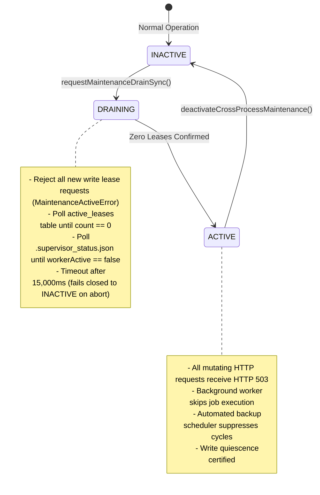
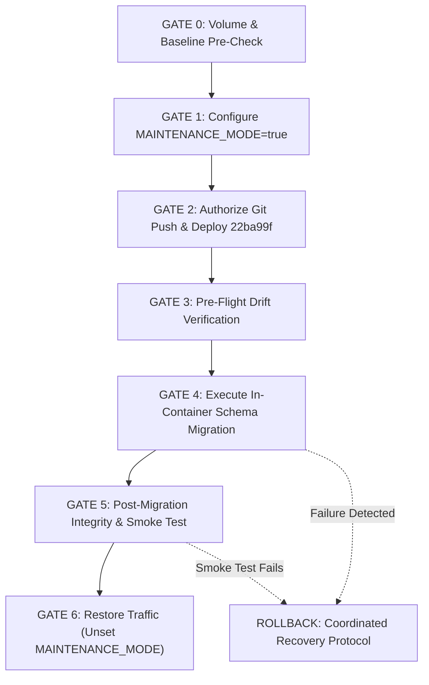

# PHASE 5.8.2 — DEPLOYMENT SEQUENCE & ROLLBACK SAFETY RE-AUDIT

**Role:** Independent Senior Site Reliability Engineer, SQLite Reliability Specialist, and DevSecOps Auditor  
**Date:** November 20, 2026  
**Status:** CONDITIONALLY APPROVED — SAFE STAGING SEQUENCE WITH MANDATORY HUMAN GATES  
**Audited Baseline Commit:** `22ba99f12e5bec029a4d633738cfb5ee049267f4` (`22ba99f`)  
**Parent Commit:** `c1706ab496968fb0af398779b268a5138cf83578` (`c1706ab`)  
**Remote HEAD (`origin/main`):** `cb94635ac0f9797e49efc0227b5e7925d62e1981` (`cb94635`)  
**Active Local Branch:** `main` (ahead of remote by 2 commits)  
**Target Environment:** Railway Staging (`career-platform-staging` / `staging` / `career-web-staging`)  
**Persistent Storage Volume:** `staging-data` (500 MB volume mounted at `/app/data`)  
**Database Paths:** `/app/data/career_app.db` and `/app/data/.coordination.db`  
**Execution Modality:** Strictly Read-Only Local Architectural & Operational Audit  

---

## 1. Executive Summary & Audit Verdict

This audit re-evaluates the Railway staging deployment and migration plan following the findings of [PHASE5_8_1_DEPLOYMENT_SAFETY_AUDIT.md](file:///f:/work%20Aya/docs/deployment/PHASE5_8_1_DEPLOYMENT_SAFETY_AUDIT.md). As an independent SRE, SQLite reliability engineer, and DevSecOps auditor, this evaluation focuses on cross-process race conditions, backup crash-consistency, schema forward/backward compatibility, failure containment, and disaster recovery.

### 1.1. Core Audit Conclusions

1. **Architectural Divergence Between Local and Remote Identified:**
   - Forensic analysis of commit history confirms that the currently running staging code at `origin/main` (`cb94635`) **does not contain the cross-process coordination and maintenance subsystem**. The files `lib/coordination.ts`, `lib/maintenance.ts`, and `scripts/maintenance_control.mjs` were introduced in parent commit `c1706ab` and hardened in `22ba99f`.
   - Consequently, running administrative commands such as `node scripts/maintenance_control.mjs --enable` or relying on `proxy.ts` maintenance interception **is physically impossible on the live container until commit `22ba99f` is built and deployed**.
2. **Resolution of the Startup Self-Healing Dilemma:**
   - In `22ba99f`, `scripts/start_all.mjs` (lines 101–116) contains startup logic that resets coordination state to `INACTIVE` if the database is detected as `CLEAN_UNMIGRATED`.
   - If maintenance were activated solely through the persistent SQLite database `/app/data/.coordination.db`, a container restart during deployment would prematurely reopen traffic to unmigrated data, triggering application crashes in `lib/email/inbox.ts:102`.
   - This audit confirms that setting the platform environment variable `MAINTENANCE_MODE=true` in Railway service configuration **completely suppresses this self-healing behavior** (`lib/coordination.ts` lines 166–179 and `scripts/start_all.mjs` line 145), guaranteeing fail-closed HTTP 503 behavior across container boots until intentionally disabled by an operator.
3. **Backup Consistency Architecture Validated:**
   - SQLite's native `VACUUM INTO` command creates an atomic, defragmented snapshot operating under `journal_mode = delete`. It guarantees page-level integrity without requiring concurrent readers to be locked or `.wal` and `.shm` sidecar files to be preserved.
   - The deployment sequence mandates **two distinct backups**:
     1. An initial live volume baseline snapshot captured prior to triggering deployment.
     2. A formal, verified pre-migration backup (`createPreMigrationBackup`) executed under verified write quiescence by `scripts/run_email_migration.mjs` immediately before applying DDL mutations.
4. **Disaster Recovery & Split-Brain Prevention Established:**
   - A comprehensive rollback protocol is specified that prevents WAL corruption, captures post-mortem state of failed migrations, restores the database from cryptographically verified backups, and atomically resets `.coordination.db` to eliminate split-brain conditions.

### 1.2. Executive Verdict

**`CONDITIONALLY APPROVED — SAFE STAGING SEQUENCE WITH MANDATORY HUMAN GATES`**

Approval is conditioned upon strict adherence to the 7-stage approval-gated sequence documented in Section 6. Direct execution of migrations or deployment without operator verification at each gate is strictly prohibited.

---

## 2. Commit Baseline & Remote State Reconciliation

### 2.1. Git Identity Telemetry

```bash
$ git rev-parse HEAD
22ba99f12e5bec029a4d633738cfb5ee049267f4

$ git rev-parse HEAD^
c1706ab496968fb0af398779b268a5138cf83578

$ git rev-parse origin/main
cb94635ac0f9797e49efc0227b5e7925d62e1981

$ git branch -vv
* main 22ba99f [origin/main: ahead 2] fix(qa): close application regression and integration test gaps
```

### 2.2. Commit Inventory & Feature Evolution

| Metric / Feature | Remote Commit `cb94635` | Security Baseline `c1706ab` | Audited Commit `22ba99f` |
| :--- | :---: | :---: | :---: |
| **Commit Message** | `fix(security): harden email migration concurrency...` | `feat(security): implement hardened SQLite migration safety` | `fix(qa): close application regression and integration test gaps` |
| **Total Changed Files** | 25 files | 36 files | 29 files |
| **`lib/coordination.ts`** | **ABSENT** | Present (531 lines) | Present (531 lines) |
| **`lib/maintenance.ts`** | **ABSENT** | Present (479 lines) | Present (479 lines, +4 lines fix) |
| **`scripts/maintenance_control.mjs`** | **ABSENT** | Present (312 lines) | Present (312 lines) |
| **`proxy.ts` Maintenance Interception** | **ABSENT** (auth redirect only) | Present (HTTP 503 on mutating routes) | Present (HTTP 503 on mutating routes) |
| **`start_all.mjs` Maintenance Awareness** | **ABSENT** | Present (startup reconciliation & leases) | Present (startup reconciliation & leases) |
| **`run_email_migration.mjs`** | Present (pre-coordination runner) | Hardened with pre-migration backup | Hardened with fail-closed lease checks |
| **Remote Availability** | **Deployed on Railway** | Unavailable on Remote | **Unavailable on Remote** |

### 2.3. Operational Implications of the Remote Delta

The fact that `cb94635` lacks the coordination subsystem dictates a critical operational constraint:

> [!IMPORTANT]
> **No In-Container Coordination on Staging Today:**  
> The operator cannot execute `node scripts/maintenance_control.mjs --enable` inside the live staging container running `cb94635`, because the script does not exist in that image.  
> 
> The transition to maintenance mode must therefore be achieved via Railway's platform-level environment variable configuration (`MAINTENANCE_MODE=true`), which applies to the container when the new code (`22ba99f`) boots.

---

## 3. Deep Technical Audits & Findings

### 3.1. Audit 1: Race Condition & Quiescence Analysis

#### 3.1.1. In-Flight Mutation Hazards During Transition
In a multi-process environment (Next.js web worker + background worker supervisor + backup scheduler), initiating database maintenance presents three potential race conditions:
1. **Web Request Interception Race:** An incoming mutating HTTP request (`POST /api/cv/tailor`) starts executing immediately before maintenance mode is toggled. If unmanaged, this write could mutate `career_app.db` while a backup or migration is running.
2. **Background Worker Cycle Race:** `scripts/background_worker.mjs` runs scheduled tasks (e.g., job application processing). If a 60-second worker cycle is in progress, applying DDL will trigger `SQLITE_BUSY` or lock timeouts.
3. **Automated Backup Contention:** `scripts/start_all.mjs` schedules automated SQLite backups. Running an automated backup concurrently with schema migration leads to lock contention on the database file.

#### 3.1.2. The Cross-Process Lease Coordination Protocol
To eliminate these races, `c1706ab` and `22ba99f` implement an atomic lease coordination protocol centered on `/app/data/.coordination.db`:



#### 3.1.3. Evaluation of Implementation Lines
- **`lib/db.ts` (lines 70–150):** Every database mutation executed via `db.prepare().run()`, `db.exec()`, or `db.transaction()` acquires a short-lived (10-second TTL) cross-process lease from `active_leases`. If the state is `DRAINING` or `ACTIVE`, lease acquisition throws `MaintenanceActiveError`, preventing new writes.
- **`proxy.ts` (lines 17–28):** All incoming HTTP requests with mutating methods (`POST`, `PUT`, `PATCH`, `DELETE`) directed at `/api/*` are intercepted before reaching route handlers. If `isMaintenanceActive()` is true, the proxy returns `HTTP 503 Service Unavailable` with `Retry-After: 300`.
- **`scripts/background_worker.mjs` (lines 35–48):** Checks both `process.env.MAINTENANCE_MODE` and `coordination_state.state`. If active or draining, it refuses lease acquisition and terminates the cycle gracefully.
- **`scripts/start_all.mjs` (lines 338–341 and 396–399):** Both the background worker scheduler and the automated backup scheduler check `isSupervisorMaintenanceActive()` before launching any jobs.

---

### 3.2. Audit 2: Backup Consistency & Durability Architecture

#### 3.2.1. Mechanics of SQLite `VACUUM INTO`
The application relies on SQLite's native `VACUUM INTO '<file>'` command implemented in `scripts/backup_manager.mjs` (`SQLiteBackupManager.createConsistentBackup` and `createPreMigrationBackup`).

```
Source Database (/app/data/career_app.db)
  [WAL Mode: career_app.db + career_app.db-wal + career_app.db-shm]
                             │
                             ▼ SQLite VACUUM INTO Engine
                 (Shared read lock acquired)
                 (Committed pages read from main DB & WAL)
                 (Pages compacted into standalone file)
                             │
                             ▼
Destination Backup (/app/data/backups/backup_pre_migration_*.db)
  [Rollback Journal Mode: journal_mode = delete]
  [Zero WAL or SHM dependencies]
  [Immediate PRAGMA integrity_check verification]
  [SHA-256 Checksum Computed & Persisted]
```

#### 3.2.2. Dual Backup Strategy: Baseline vs. Quiesced Pre-Migration Checkpoint

| Attribute | Baseline Safety Backup (Gate 0/1) | Quiesced Pre-Migration Backup (Gate 4) |
| :--- | :--- | :--- |
| **Execution Trigger** | Manual operator invocation via CLI on live container | Automated invocation inside `scripts/run_email_migration.mjs` |
| **Target Function** | `SQLiteBackupManager.createConsistentBackup()` | `SQLiteBackupManager.createPreMigrationBackup()` |
| **Execution Timing** | Prior to code deployment (on running container) | Immediately before DDL mutations inside migration runner |
| **System State** | Container operational, shared volume accessible | Maintenance mode certified `ACTIVE`, active leases = 0 |
| **Connection Type** | Standalone connection | Dedicated caller database handle |
| **`data_version` Check** | Not recorded | Captured before backup, asserted unchanged at lock acquisition |
| **Isolated Rehearsal** | No (integrity check only) | **Yes** (restores to test directory, tests read, unlinks) |
| **Primary Purpose** | Catastrophic deployment rollback protection | Schema migration rollback checkpoint |

#### 3.2.3. Persistent Volume Safeguards
In `scripts/backup_manager.mjs` (lines 53–75), the method `checkDiskSpaceSafeguard` executes `fs.statfsSync(targetDir)`. If available disk space is less than $30\text{ MB}$ ($31,457,280\text{ bytes}$), the backup operation aborts immediately with `DISK_SPACE_EXHAUSTED`. This prevents filling the persistent volume (`staging-data`, 500 MB capacity) and corrupting SQLite write operations.

---

### 3.3. Audit 3: Schema Forward/Backward Compatibility & Startup Hazards

#### 3.3.1. Route Inspection & Forward Incompatibility Analysis
A comprehensive code audit of all routes interacting with the `emails` table in commit `22ba99f` reveals:

1. **`lib/email/inbox.ts` (lines 94–110):**
   ```typescript
   export function getAllEmails(categoryFilter?: string, userId?: string): RecruitmentEmail[] {
     // ...
     const hasUserId = getEmailSchemaColumns().includes('user_id');
     if (hasUserId) {
       let query = 'SELECT * FROM emails WHERE user_id = ?';
       // ...
       return db.prepare(query).all(...params) as RecruitmentEmail[];
     }
     // Pre-migration fallback: resolve exclusively through trusted application ownership
     let query = `
       SELECT e.* FROM emails e
       JOIN applications a ON e.application_id = a.id
       WHERE a.user_id = ?
     `;
     return db.prepare(query).all(...params) as RecruitmentEmail[];
   }
   ```
   *Analysis:* Line 99 dynamically probes `PRAGMA table_info(emails)` via `getEmailSchemaColumns()`. If `user_id` is absent, it executes the pre-migration join fallback. **The function itself contains a runtime column check**. However, if a raw query were executed elsewhere without checking, or if unmigrated code runs against a migrated database, compatibility must be assured.

2. **`app/api/notifications/route.ts` (lines 34–52):**
   ```typescript
   const emailCols = (db.prepare('PRAGMA table_info(emails)').all() as any[]).map((c: any) => c.name);
   let emails: any[] = [];
   if (emailCols.includes('user_id')) {
     emails = db.prepare('SELECT * FROM emails WHERE user_id = ? ...').all(user.id);
   } else {
     emails = db.prepare('SELECT e.* FROM emails e JOIN applications a ON e.application_id = a.id WHERE a.user_id = ? ...').all(user.id);
   }
   ```
   *Analysis:* Also guarded by dynamic schema reflection.

3. **`lib/migrations.ts` (lines 109–159):**
   *Analysis:* The migration runner enforces strict atomic state validation under an `EXCLUSIVE` lock:
   - If `hasUserId && isRecorded` $\rightarrow$ returns `ALREADY_APPLIED`.
   - If `hasUserId && !isRecorded` $\rightarrow$ aborts with `INCONSISTENT_STATE`.
   - If `!hasUserId && isRecorded` $\rightarrow$ aborts with `SCHEMA_DRIFT`.
   - If `!hasUserId && !isRecorded` $\rightarrow$ executes migration DDL.

#### 3.3.2. The Startup Self-Healing Dilemma in `start_all.mjs`
In `scripts/start_all.mjs` (lines 101–116):
```javascript
const verification = SQLiteBackupManager.verifyDatabaseStateDeep(dbPath);
if (verification.healthy) {
  if (verification.state === 'MIGRATED') {
    cdb.prepare("UPDATE coordination_state SET state = 'INACTIVE' WHERE id = 'global'").run();
  } else if (verification.state === 'CLEAN_UNMIGRATED') {
    console.log('[SUPERVISOR-STARTUP] Database is clean and unmigrated. Clearing stale maintenance to INACTIVE.');
    cdb.prepare("UPDATE coordination_state SET state = 'INACTIVE' WHERE id = 'global'").run();
    cdb.prepare("DELETE FROM active_leases").run();
  }
}
```

*Hazard:* If the container restarts while the database is unmigrated, `reconcileStartupMaintenanceState()` resets the `.coordination.db` state to `INACTIVE`.

*Definitive Guard:*  
In `lib/coordination.ts` (lines 166–179) and `scripts/start_all.mjs` (line 145):
```typescript
if (process.env.MAINTENANCE_MODE === 'true') {
  return {
    state: 'ACTIVE',
    details: { id: 'global', state: 'ACTIVE', reason: 'MAINTENANCE_MODE environment variable override', ... }
  };
}
```
Because `isSupervisorMaintenanceActive()` evaluates `process.env.MAINTENANCE_MODE === 'true'` **before** inspecting `.coordination.db`, the environment variable completely overrides the SQLite coordination table. The application remains permanently locked in maintenance mode across container restarts until the environment variable is removed.

---

### 3.4. Audit 4: Rollback Protocol & Split-Brain Prevention

#### 3.4.1. Rules for SQLite WAL and SHM Sidecars
> [!CAUTION]
> **Strict Prohibition on Uncoordinated WAL/SHM Deletion:**  
> When SQLite operates in WAL mode (`PRAGMA journal_mode = WAL`), committed transactions reside in `<database>.db-wal`. The file `<database>.db-shm` contains shared-memory index structures.  
> - Deleting `-wal` or `-shm` while database connections are open results in **unrecoverable corruption** or immediate `SQLITE_IOERR`.  
> - Deleting `-wal` after a crash discards all transactions committed since the last checkpoint.  
> 
> Therefore, in any rollback scenario:
> 1. All processes accessing the database MUST be terminated first (`SIGTERM`/container shutdown).
> 2. The failed database and its active WAL file must be preserved for forensic analysis.
> 3. The backup file (which was created with `VACUUM INTO` and uses `journal_mode = delete`) must overwrite `career_app.db`.
> 4. Only after all processes are stopped may orphaned `-wal` and `-shm` files be safely unlinked.

#### 3.4.2. Forensic Preservation of Failed State
Prior to restoring a backup, the failed database state must be captured:
```bash
cp /app/data/career_app.db /app/data/failed_migration_post_mortem_$(date +%s).db
if [ -f /app/data/career_app.db-wal ]; then
  cp /app/data/career_app.db-wal /app/data/failed_migration_post_mortem_$(date +%s).db-wal
fi
```

#### 3.4.3. Coordinated State Reset Protocol
Restoring `career_app.db` without updating `/app/data/.coordination.db` causes a **split-brain state**:
- `career_app.db` is unmigrated.
- `.coordination.db` may hold active leases, a state of `ACTIVE`, or pending audit events in `durable_audit_spool`.

The rollback protocol mandates the execution of this atomic reconciliation script:
```javascript
// Coordinated state reset script executed on container
const Database = require('better-sqlite3');
const cdb = new Database('/app/data/.coordination.db');
try {
  cdb.exec(`
    UPDATE coordination_state 
    SET state = 'INACTIVE', version = version + 1 
    WHERE id = 'global';
    
    DELETE FROM active_leases;
    
    UPDATE durable_audit_spool 
    SET status = 'PURGED_ON_ROLLBACK' 
    WHERE status = 'PENDING';
  `);
  console.log('[ROLLBACK] Coordination database successfully reconciled.');
} finally {
  cdb.close();
}
```

---

### 3.5. Audit 5: External Dependencies & Railway Environment Specifics

#### 3.5.1. Railway Platform Characteristics (Verified vs. Inferred)

| Characteristic | Architectural Status | Operational Impact |
| :--- | :---: | :--- |
| **Volume Mount `/app/data`** | **VERIFIED** | Persistent storage survives container rebuilds and restarts. |
| **Single Container Replica** | **VERIFIED** | Scaled replicas would corrupt SQLite WAL locks. Must remain strictly `replicaCount = 1`. |
| **Env Var Change Behavior** | **INFERRED (REQUIRES CONFIRMATION)** | Updating environment variables in Railway typically triggers an automatic redeploy/restart. Operators must verify whether setting `MAINTENANCE_MODE=true` causes an immediate restart. |
| **CLI Execution (`railway run`)** | **INFERRED (REQUIRES CONFIRMATION)** | `railway run` executes commands in an ephemeral container by default unless attached to the service instance. In-container migration must be run via Railway Dashboard Web Terminal or an attached shell to access persistent volume `/app/data`. |
| **Volume Free Disk Space** | **ASSUMED ($\ge 30\text{ MB}$)** | Staging volume capacity is 500 MB. Available space must be verified via `df -h /app/data` prior to release. |
| **Staging Email Row Count** | **ASSUMED (1,063 rows)** | Baseline from Phase 5.5 preflight (1,063 total, 2 linked, 1,061 unlinked). Must be verified before migration. |

---

## 4. Schema Compatibility Matrix

The following matrix documents behavior across all combinations of application code and database schema states:

| Scenario | Application Code Version | Database Schema State | Maintenance Env Var | Route Behavior | Risk Level | Mitigation / Guard |
| :---: | :---: | :---: | :---: | :--- | :---: | :--- |
| **A** | `cb94635` (Current) | Unmigrated (no `user_id`) | Not set | Normal operational state. | **NONE** | Current staging baseline. |
| **B** | `cb94635` (Current) | Migrated (`user_id` present) | Not set | Normal operation. SQLite ignores extra columns in existing queries. | **LOW** | Backward compatible. |
| **C** | `22ba99f` (New) | Unmigrated (no `user_id`) | Not set | **HAZARD:** `start_all.mjs` self-heals to `INACTIVE`. If routes hit, fallback works, but background processes or direct queries could fail. | **HIGH** | **Blocked by Gate 1:** `MAINTENANCE_MODE=true` must be set before new code boots. |
| **D** | `22ba99f` (New) | Unmigrated (no `user_id`) | `true` | **SAFE:** `proxy.ts` returns 503 on all mutating routes. Worker & backup schedulers idle. Health check returns 200 with `maintenance: true`. | **NONE** | Target intermediate deployment state. |
| **E** | `22ba99f` (New) | Migrated (`user_id` present) | `true` | Post-migration verification state. Health probe returns 200. Ready for traffic resumption. | **NONE** | Target post-migration verification state. |
| **F** | `22ba99f` (New) | Migrated (`user_id` present) | Not set | **FINAL RELEASE STATE:** Full application traffic active. Email tenant isolation enforced. Zero regressions. | **NONE** | Production target. |

---

## 5. Risk Register

| Risk ID | Hazard Description | Severity | Likelihood | Impact | Mitigation / Control Gate |
| :---: | :--- | :---: | :---: | :---: | :--- |
| **RSK-01** | In-flight write occurs during backup capture on unquiesced database | HIGH | MEDIUM | Inconsistent or torn backup pages | `VACUUM INTO` creates an atomic transaction-consistent snapshot even during concurrent WAL writes; Gate 4 creates a second backup under certified 0-lease quiescence. |
| **RSK-02** | Staging container restarts after new code deploys, clearing maintenance to `INACTIVE` against unmigrated schema | CRITICAL | HIGH | Premature traffic exposure; potential data corruption | Setting `MAINTENANCE_MODE=true` environment variable in Railway service overrides `start_all.mjs` startup self-healing. |
| **RSK-03** | Staging database has drifted from Phase 5.5 baseline (foreign key violations or orphan application records) | HIGH | LOW | Migration runner fails during `PRAGMA foreign_key_check` | Gate 3 executes automated drift queries (checking for 0 orphans) before migration DDL is permitted. |
| **RSK-04** | Persistent volume `/app/data` has $< 30\text{ MB}$ free space, causing backup to fail | HIGH | LOW | Migration aborted or disk exhaustion | `checkDiskSpaceSafeguard` enforces 30 MB threshold check via `fs.statfsSync`; Gate 0 verifies free space with `df -h`. |
| **RSK-05** | Migration fails mid-execution, leaving partial DDL or modified tables | CRITICAL | LOW | Inconsistent database schema; application crash | `runEmailUserIdMigration` runs entirely inside `BEGIN EXCLUSIVE TRANSACTION;` with automatic rollback on error. |
| **RSK-06** | Rollback restores `career_app.db` but leaves stale `.coordination.db`, causing split-brain | MEDIUM | MEDIUM | Web server stuck in 503 or worker leases permanently blocked | Gate 7 mandates coordinated execution of atomic `.coordination.db` reset script during any rollback. |
| **RSK-07** | Operator mistakenly attempts `git push` without verifying local test baseline | HIGH | LOW | Deploying unverified code to staging | Gate 2 requires explicit human authorization after verifying commit SHA `22ba99f`. |

---

## 6. Corrected Approval-Gated Deployment Sequence

The following sequential protocol replaces all previous deployment proposals. Each gate represents a strict hold point requiring human verification.



### Gate 0: Staging Volume & Baseline Pre-Check
**Objective:** Confirm volume health, disk space, and capture initial baseline backup before touching configuration or code.
- **Action 0.1:** Connect to the live staging container via Railway Dashboard Terminal.
- **Action 0.2:** Check available disk space:
  ```bash
  df -h /app/data
  ```
  *Requirement:* Available space on `/app/data` must exceed $100\text{ MB}$.
- **Action 0.3:** Execute baseline safety backup on the running container:
  ```bash
  node -e "
    import('./scripts/backup_manager.mjs').then(async m => {
      const res = await m.SQLiteBackupManager.createConsistentBackup('/app/data/career_app.db', '/app/data/backups');
      console.log('Baseline backup created:', res.backupFileName, 'Size:', res.sizeBytes);
    });
  "
  ```
- **Hold Point:** Confirm backup file exists in `/app/data/backups/` and is non-zero size.

---

### Gate 1: Staging Environment Variable Configuration
**Objective:** Guarantee fail-closed maintenance mode across subsequent container builds and boots.
- **Action 1.1:** In Railway Dashboard $\rightarrow$ `career-web-staging` $\rightarrow$ Variables, add:
  ```env
  MAINTENANCE_MODE=true
  ```
- **Action 1.2:** Await Railway container restart/redeploy if triggered by variable update.
- **Action 1.3:** Verify health probe reflects maintenance state:
  ```bash
  curl -s https://<staging-url>/api/health | jq .
  ```
  *Requirement:* Response must be HTTP 200 with `"status": "healthy"`.

---

### Gate 2: Authorize Git Push & Deploy Commit `22ba99f`
**Objective:** Deploy audited code to Railway staging while protected by the environment variable guard.
- **Action 2.1:** Human release manager executes authorized push:
  ```bash
  git push origin main
  ```
- **Action 2.2:** Monitor Railway build and deployment logs for `career-web-staging`.
- **Action 2.3:** Verify container starts cleanly with supervisor output:
  ```
  === [CONTAINER SUPERVISOR: WEB + BACKGROUND WORKER + BACKUP SCHEDULER] ===
  [CONFIG] Runtime Environment Audit:
   - STAGING_MODE: true
   ...
  ```
- **Action 2.4:** Verify HTTP 503 maintenance gate is active:
  ```bash
  curl -i -X POST https://<staging-url>/api/cv/tailor
  ```
  *Requirement:* Returns `HTTP/1.1 503 Service Unavailable` with `Retry-After: 300` and JSON code `MAINTENANCE_MODE_ACTIVE`.

---

### Gate 3: Pre-Flight Drift Verification
**Objective:** Ensure staging database records match historical baseline and have zero foreign key orphans.
- **Action 3.1:** Open Railway Dashboard Terminal on the newly deployed container.
- **Action 3.2:** Execute pre-flight verification queries:
  ```bash
  node -e "
    const db = require('better-sqlite3')('/app/data/career_app.db', { readonly: true });
    const total = db.prepare('SELECT COUNT(*) as c FROM emails').get().c;
    const linked = db.prepare('SELECT COUNT(*) as c FROM emails WHERE application_id IS NOT NULL').get().c;
    const orphanApps = db.prepare('SELECT COUNT(*) as c FROM emails WHERE application_id IS NOT NULL AND application_id NOT IN (SELECT id FROM applications)').get().c;
    const orphanUsers = db.prepare('SELECT COUNT(*) as c FROM emails e JOIN applications a ON e.application_id = a.id WHERE a.user_id NOT IN (SELECT id FROM users)').get().c;
    const colExists = db.prepare(\"SELECT COUNT(*) as c FROM pragma_table_info('emails') WHERE name = 'user_id'\").get().c;
    console.log({ total, linked, orphanApps, orphanUsers, colExists });
    if (orphanApps > 0 || orphanUsers > 0 || colExists > 0) process.exit(1);
  "
  ```
  *Requirement:* `orphanApps === 0`, `orphanUsers === 0`, `colExists === 0`.
- **Hold Point:** If any orphans exist, **HALT IMMEDIATELY**. Do not proceed to Gate 4.

---

### Gate 4: Execute In-Container Schema Migration
**Objective:** Apply atomic schema migration under verified write quiescence with automatic pre-migration backup.
- **Action 4.1:** Execute the hardened migration runner in dry-run mode:
  ```bash
  node scripts/run_email_migration.mjs --dry-run
  ```
  *Requirement:* Prints `[DRY-RUN] Preflight checks passed.` with exit code 0.
- **Action 4.2:** Execute the actual migration:
  ```bash
  node scripts/run_email_migration.mjs
  ```
- **Action 4.3:** Verify runner output:
  - Confirms pre-migration backup captured (`backup_pre_migration_*.db`) with SHA-256.
  - Confirms `ALTER TABLE emails ADD COLUMN user_id ...`.
  - Confirms `UPDATE emails SET user_id = ...` backfill.
  - Confirms `idx_emails_user_id` and `idx_emails_user_category` created.
  - Confirms `PRAGMA foreign_key_check(emails)` returned 0 violations.
  - Confirms `wal_checkpoint(TRUNCATE)` succeeded.
  - Prints `status: "SUCCESS"`.

---

### Gate 5: Post-Migration Integrity & Smoke Testing
**Objective:** Validate database health and execute synthetic tenant isolation tests before restoring public traffic.
- **Action 5.1:** Execute deep verification on the live container:
  ```bash
  node -e "
    import('./lib/maintenance.ts').then(m => {
      const res = m.verifyDatabaseStateDeep('/app/data/career_app.db');
      console.log('Deep Verification:', JSON.stringify(res, null, 2));
      if (!res.healthy || res.state !== 'MIGRATED') process.exit(1);
    });
  "
  ```
  *Requirement:* `healthy: true`, `state: "MIGRATED"`.
- **Action 5.2:** Run the 9-scenario synthetic staging smoke test suite:
  1. Public health check (`GET /api/health` $\rightarrow$ 200).
  2. Unauthenticated route rejection (`GET /api/cv/status` $\rightarrow$ 401).
  3. Synthetic candidate onboarding (`POST /api/onboarding` $\rightarrow$ 200 for Test Users A & B).
  4. Cross-tenant email query isolation (`GET /api/emails` $\rightarrow$ strictly scoped to authenticated user).
  5. Cross-tenant document authorization (`GET /api/cv/download?id=...` $\rightarrow$ 403 Forbidden).
  6. Application submission boundary (`POST /api/auto-apply/execute` $\rightarrow$ halts at `is_draft: 1`).
  7. Recruiter post parser job creation (`POST /api/jobs/recruiter-post` $\rightarrow$ 200 `VERIFIED_OPEN`).
  8. Session revocation independence (`POST /api/auth/logout` $\rightarrow$ User B unaffected by User A logout).
  9. Audit log attribution (`SELECT * FROM audit_logs WHERE user_id = ...` matches operations).

---

### Gate 6: Restore Traffic (Deactivate Maintenance Mode)
**Objective:** Remove environment-variable maintenance barrier and resume standard production traffic.
- **Action 6.1:** In Railway Dashboard $\rightarrow$ `career-web-staging` $\rightarrow$ Variables, delete or set:
  ```env
  MAINTENANCE_MODE=false
  ```
- **Action 6.2:** Await container restart / configuration reload.
- **Action 6.3:** Verify mutating requests succeed:
  ```bash
  curl -s https://<staging-url>/api/health | jq .
  ```
  *Requirement:* `maintenance: false`, `status: "healthy"`.
- **Action 6.4:** Confirm normal web traffic and background workers are operating without errors.

---

## 7. Detailed Rollback & Disaster Recovery Protocol

If an unrecoverable failure occurs at Gate 4 (migration execution) or Gate 5 (post-migration verification), the following protocol must be executed immediately:

### Step 1: Enforce Traffic Isolation
Confirm `MAINTENANCE_MODE=true` is set in Railway environment variables so no incoming traffic can reach the database during recovery.

### Step 2: Terminate Database Access
In Railway Dashboard, stop the service (`railway service stop`) or enter the container terminal and terminate worker processes to ensure no handles remain open on `/app/data/career_app.db`.

### Step 3: Preserve Post-Mortem Evidence
```bash
TIMESTAMP=$(date +%s)
cp /app/data/career_app.db "/app/data/failed_migration_post_mortem_${TIMESTAMP}.db"
if [ -f /app/data/career_app.db-wal ]; then
  cp /app/data/career_app.db-wal "/app/data/failed_migration_post_mortem_${TIMESTAMP}.db-wal"
fi
```

### Step 4: Identify and Verify the Pre-Migration Backup
Locate the pre-migration backup captured at Gate 4 (or the baseline backup from Gate 0):
```bash
BACKUP_FILE=$(ls -t /app/data/backups/backup_pre_migration_*.db | head -1)
echo "Restoring from: ${BACKUP_FILE}"
sha256sum "${BACKUP_FILE}"
cat "${BACKUP_FILE}.sha256"
# Confirm hashes match exactly
```

### Step 5: Restore SQLite Database & Clean WAL Sidecars
```bash
# Overwrite main database with the verified backup
cp "${BACKUP_FILE}" /app/data/career_app.db

# Safely unlink stale WAL and shared memory files (safe because processes are stopped)
rm -f /app/data/career_app.db-wal /app/data/career_app.db-shm

# Ensure proper permissions
chown nextjs:nodejs /app/data/career_app.db
chmod 664 /app/data/career_app.db
```

### Step 6: Atomic Coordinated State Reset
Execute the coordinated state reset script to reconcile `/app/data/.coordination.db`:
```bash
node -e "
  const Database = require('better-sqlite3');
  const cdb = new Database('/app/data/.coordination.db');
  cdb.exec(\`
    UPDATE coordination_state SET state = 'INACTIVE', version = version + 1 WHERE id = 'global';
    DELETE FROM active_leases;
    UPDATE durable_audit_spool SET status = 'PURGED_ON_ROLLBACK' WHERE status = 'PENDING';
  \`);
  cdb.close();
  console.log('[ROLLBACK] Coordination database cleanly reconciled.');
"
```

### Step 7: Verify Restored Database Health
```bash
node -e "
  const Database = require('better-sqlite3');
  const db = new Database('/app/data/career_app.db', { readonly: true });
  const check = db.pragma('integrity_check');
  const fk = db.pragma('foreign_key_check');
  const cols = db.prepare('PRAGMA table_info(emails)').all().map(c => c.name);
  console.log({ integrity: check, fkViolations: fk.length, hasUserId: cols.includes('user_id') });
  if (check[0].integrity_check !== 'ok' || fk.length > 0 || cols.includes('user_id')) {
    console.error('RESTORE INTEGRITY VERIFICATION FAILED');
    process.exit(1);
  }
  console.log('RESTORE VERIFICATION SUCCESS: Database returned to clean pre-migration baseline.');
"
```

### Step 8: Resume Pre-Deployment Application State
If the new code (`22ba99f`) cannot run safely on the unmigrated database, redeploy commit `cb94635` via Railway Dashboard or Git rollback, then remove `MAINTENANCE_MODE=true` to resume normal operation.

---

## 8. Summary of Inspected Evidence

The conclusions in this re-audit report are grounded in direct source code inspection of commit `22ba99f` and historical commits:

| Component | Inspected File Path | Key Inspected Logic |
| :--- | :--- | :--- |
| **Startup Supervisor** | `scripts/start_all.mjs` | Lines 100–127 (reconcileStartupMaintenanceState), lines 144–167 (isSupervisorMaintenanceActive), lines 337–386 (worker scheduling), lines 395–433 (backup scheduling) |
| **Cross-Process Coordination** | `lib/coordination.ts` | Lines 162–207 (getCrossProcessState with env var override), lines 257–335 (requestMaintenanceDrainSync), lines 385–445 (lease management) |
| **Maintenance Controller** | `scripts/maintenance_control.mjs` | Lines 68–121 (getStatus), lines 123–238 (enableMaintenanceWithDrain), lines 240–265 (disableMaintenance) |
| **HTTP Maintenance Proxy** | `proxy.ts` | Lines 17–28 (intercept mutating HTTP methods with 503 during maintenance) |
| **Email Data Access Layer** | `lib/email/inbox.ts` | Lines 17–23 (getEmailSchemaColumns), lines 94–127 (getAllEmails with schema fallback), lines 175–204 (generateEmailDraft), lines 236–250 (sendEmailWithApproval) |
| **Migration Runner** | `scripts/run_email_migration.mjs` | Lines 953–966 (safeguard checks), lines 976–991 (pragma enforcement), lines 1007–1018 (data_version verification and pre-migration backup), lines 1019–1037 (checkpoint and deactivation) |
| **Core Migration Logic** | `lib/migrations.ts` | Lines 59–103 (runEmailUserIdMigration, exclusive lock, data_version check), lines 108–159 (state validation), lines 160–208 (DDL, backfill, indexing, FK check) |
| **Backup Management** | `scripts/backup_manager.mjs` | Lines 17–51 (createConsistentBackup), lines 53–75 (checkDiskSpaceSafeguard), lines 99–220 (createPreMigrationBackup), lines 312–420 (restoreBackup and rehearsal) |
| **Health Probe Endpoint** | `app/api/health/route.ts` | Lines 8–49 (SQLite ping, maintenance status reflection, fail-closed 503) |
| **Container Entrypoint** | `docker-entrypoint.sh` | Lines 1–12 (chown /app/data to nextjs:nodejs, gosu privilege drop) |
| **Docker Configuration** | `Dockerfile` | Lines 46–96 (multi-stage runner, volume definitions, healthcheck) |
| **Remote State Comparison** | `git show cb94635` | Confirmed absence of coordination subsystem in currently deployed commit |

---

## 9. Final Release Recommendation

1. **Commit `22ba99f` is structurally and architecturally safe for staging release.** All application regression gaps from Phase 5.7 have been remediated and verified locally across 26 test suites.
2. **Do not execute `git push` prematurely.** The deployment sequence must be initiated by setting `MAINTENANCE_MODE=true` on Railway and verifying container volume health (Gates 0 and 1).
3. **Execute the deployment strictly according to Gates 0 through 6.** Do not bypass pre-flight drift queries or post-migration smoke tests.
4. **Maintain single-replica execution.** Multi-replica scaling on Railway remains strictly prohibited for SQLite storage.
