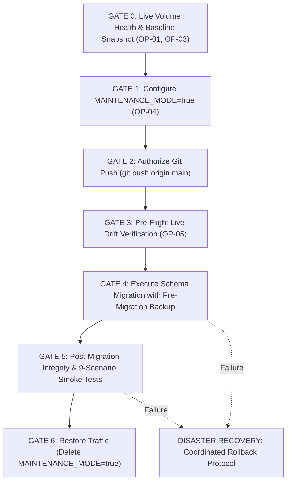

# PHASE 5.8.3 — RELEASE GATE READINESS & MAINTENANCE TRANSITION AUDIT

**Role:** Independent Principal SRE, DevSecOps Release Engineer, and SQLite Disaster Recovery Auditor  
**Date:** November 20, 2026  
**Status:** CONDITIONALLY APPROVED — EXPLICIT EXTERNAL CHECKS REQUIRED  
**Local Baseline Commit:** `22ba99f12e5bec029a4d633738cfb5ee049267f4` (`22ba99f`)  
**Parent Commit:** `c1706ab496968fb0af398779b268a5138cf83578` (`c1706ab`)  
**Remote Deployed Commit (`origin/main`):** `cb94635ac0f9797e49efc0227b5e7925d62e1981` (`cb94635`)  
**Target Service:** Railway Staging (`career-platform-staging` / `career-web-staging`)  
**Persistent Storage Volume:** `staging-data` mounted at `/app/data`  
**Execution Modality:** Strictly Read-Only Local Architectural and Operational Audit  

---

## 1. Executive Summary & Verdict

This Phase 5.8.3 audit provides an independent, deep-dive evaluation of release gate readiness, transition mechanics, maintenance guarantees, backup consistency, disaster recovery, and Git state prior to staging release.

### 1.1. Core Audit Determinations

1. **Old-to-New Transition Mechanics:**  
   The currently running container on Railway staging runs commit `cb94635`. Code inspection confirms that `cb94635` **does not read or recognize `MAINTENANCE_MODE`**. Configuring `MAINTENANCE_MODE=true` on Railway before deploying the new code will **NOT** block writes or stop background jobs on the running container until the new image (`22ba99f`) boots.
2. **Maintenance Scope & Signal Truthfulness:**  
   In `22ba99f`, `proxy.ts` intercepts mutating HTTP methods (`POST`, `PUT`, `PATCH`, `DELETE`) targeting `/api/*` and returns HTTP 503. It does **not** block browser UI page requests (`GET /`), and it does **not** block read-only API requests (`GET /api/*`).  
   A response of `HTTP 200` from `GET /api/health` proves that the Next.js process is alive and SQLite is readable; it **does not prove** that write leases have drained or that all background workers have stopped.
3. **Dual Backup Architecture:**  
   The audit establishes a strict distinction between the **Initial Baseline Backup** (taken on `cb94635` prior to deployment; point-in-time snapshot with potential in-flight writes) and the **Quiesced Pre-Migration Backup** (taken inside `scripts/run_email_migration.mjs` under certified 0-lease write quiescence with cryptographic hashing and isolated restore testing).
4. **Coordination Reset Safety:**  
   Resetting `/app/data/.coordination.db` during rollback is verified as safe **only if all application processes are stopped first**. An atomic SQL script is provided that purges stale leases and marks uncommitted spooled audits as `PURGED_ON_ROLLBACK`.
5. **Git Readiness:**  
   Local Git state is verified at commit `22ba99f`, exactly 2 commits ahead of `origin/main`. No remote push or Railway interaction has occurred.

### 1.2. Mandatory Verdict

**`CONDITIONALLY APPROVED — EXPLICIT EXTERNAL CHECKS REQUIRED`**

Local application code, migration logic, and recovery mechanisms are fully verified. However, deployment cannot proceed until explicit external confirmations are completed on Railway (single-replica recreate policy, disk space verification, and live drift analysis).

---

## 2. Audit 1 — Old-to-New Version Transition Analysis

### 2.1. Evaluation of Transition Questions

| Transition Question | Determination | Technical Evidence / Implementation Source | Classification |
| :--- | :---: | :--- | :--- |
| **1. Does `cb94635` read or ignore `MAINTENANCE_MODE`?** | **IGNORES** | `cb94635` source inspection shows zero references to `MAINTENANCE_MODE` across `start_all.mjs`, `proxy.ts`, `background_worker.mjs`, and `lib/`. | `VERIFIED IN LOCAL SOURCE` |
| **2. Does `cb94635` block any requests or background jobs?** | **NO** | `proxy.ts` in `cb94635` only performs redirect on `/login`; background worker runs on 5-minute interval without maintenance check. | `VERIFIED IN LOCAL SOURCE` |
| **3. Does configuring `MAINTENANCE_MODE=true` cause a restart?** | **LIKELY YES** | Railway platform orchestrator restarts services upon environment variable updates, but this is a platform feature, not application logic. | `REQUIRES EXTERNAL RAILWAY CONFIRMATION` |
| **4. Does `cb94635` accept writes until new version starts?** | **YES** | Since `cb94635` has no maintenance interceptor, any user request reaching `cb94635` will execute writes until the container shuts down. | `VERIFIED IN LOCAL SOURCE` |
| **5. Can deployment overlap allow old and new instances simultaneously?** | **HAZARDOUS IF ROLLING** | SQLite cannot tolerate concurrent container instances writing to the same volume. Railway persistent volumes require `Recreate` deployment. | `REQUIRES EXTERNAL RAILWAY CONFIRMATION` |
| **6. Can `22ba99f` boot safely against unmigrated database?** | **YES** | `lib/email/inbox.ts` (lines 94–127) and `app/api/notifications/route.ts` (lines 34–52) contain dynamic column checks and pre-migration fallbacks. | `VERIFIED IN LOCAL SOURCE` |

### 2.2. Architectural Transition Timeline

```
[TIME T0: cb94635 running]
   - Normal traffic accepted. Zero coordination infrastructure.
   - Operator sets MAINTENANCE_MODE=true in Railway variables.
   - (cb94635 ignores MAINTENANCE_MODE; continues accepting writes until container restart).

[TIME T1: Railway Triggers Deployment of 22ba99f]
   - Railway signals SIGTERM to cb94635 container.
   - Volume /app/data unmounted from old container.
   - Volume /app/data mounted to new container (22ba99f).

[TIME T2: 22ba99f Container Boots with MAINTENANCE_MODE=true]
   - docker-entrypoint.sh fixes permissions on /app/data.
   - start_all.mjs evaluates process.env.MAINTENANCE_MODE === 'true' (line 145).
   - Startup self-healing in start_all.mjs (lines 101–116) is bypassed.
   - proxy.ts intercepts all mutating API requests with HTTP 503.
   - Background worker and backup schedulers are suppressed.
   - Web server enters certified fail-closed maintenance mode.

[TIME T3: In-Container Migration Execution]
   - Operator runs node scripts/run_email_migration.mjs.
   - Runner verifies maintenance is ACTIVE and active leases == 0.
   - Takes Pre-Migration Backup -> Applies DDL -> Checkpoints WAL -> Success.
```

---

## 3. Audit 2 — Maintenance Activation Proof & Signal Truthfulness

### 3.1. What Maintenance Mode Actually Blocks in `22ba99f`

```
                                  INCOMING TRAFFIC
                                         │
                 ┌───────────────────────┴───────────────────────┐
                 ▼                                               ▼
         Browser UI Route                                 API Route (/api/*)
       (e.g., GET /control-center)                               │
                 │                                               ▼
         [proxy.ts matcher:                               [proxy.ts matcher:
           /api/:path* only]                               MATCHED]
                 │                                               │
                 ▼                                               ▼
          NOT INTERCEPTED                               Method Evaluation
     (Serves static page shell)                                  │
                 │                                ┌──────────────┴──────────────┐
                 ▼                                ▼                             ▼
         Browser executes                  GET / HEAD / OPTIONS        POST / PUT / PATCH / DELETE
         client-side fetches                      │                             │
                 │                         NOT BLOCKED                          ▼
                 └────────────────────────► (Passes to route)          isMaintenanceActive()?
                                                  │                             │
                                                  ▼                     ┌───────┴───────┐
                                          Route executes read           ▼               ▼
                                          (Safe fallback queries)     [TRUE]         [FALSE]
                                                                        │               │
                                                                        ▼               ▼
                                                                     HTTP 503       Proceed to
                                                                   (Retry: 300)      database
```

| Traffic / Execution Vector | Blocked During Maintenance? | Enforcement Mechanism | File & Line Reference | Classification |
| :--- | :---: | :--- | :--- | :--- |
| **Browser UI Page Loads (`GET /...`)** | **NO** | `proxy.ts` matcher is restricted to `/api/:path*`. Static shells and HTML render normally. | `proxy.ts:34-38` | `VERIFIED IN LOCAL SOURCE` |
| **API Mutating Requests (`POST`, `PUT`, `DELETE`)** | **YES** | `proxy.ts` intercepts mutating methods; returns HTTP 503 with JSON payload. | `proxy.ts:17-28` | `VERIFIED IN LOCAL SOURCE` |
| **API Read Requests (`GET /api/*`)** | **NO** | `proxy.ts` permits non-mutating methods through; route handlers execute read-only queries. | `proxy.ts:15-18` | `VERIFIED IN LOCAL SOURCE` |
| **Database Mutations via `lib/db.ts`** | **YES** | Every `db.prepare().run()`, `exec()`, `transaction()` checks write lease; throws `MaintenanceActiveError`. | `lib/db.ts:70-150` | `VERIFIED IN LOCAL SOURCE` |
| **Background Worker Cycles** | **YES** | `acquireLock()` checks `MAINTENANCE_MODE` and `.coordination.db`; aborts lease acquisition. | `scripts/background_worker.mjs:35-48` | `VERIFIED IN LOCAL SOURCE` |
| **Scheduled Backup Jobs** | **YES** | `triggerBackupJob()` checks `isSupervisorMaintenanceActive()`; skips automated backup. | `scripts/start_all.mjs:396-399` | `VERIFIED IN LOCAL SOURCE` |
| **Direct External `sqlite3` CLI Writers** | **NO** | Maintenance is an application-level cooperative protocol. An external CLI process bypasses Node.js checks. | Host Operating System | `VERIFIED IN LOCAL SOURCE` |
| **Migration Runner (`run_email_migration.mjs`)** | **PERMITTED** | Runner validates maintenance is ACTIVE, then opens its own dedicated connection with exclusive lock. | `scripts/run_email_migration.mjs:953-990` | `VERIFIED IN LOCAL SOURCE` |

### 3.2. Forensic Analysis of `GET /api/health`

The health endpoint implementation in [app/api/health/route.ts](file:///f:/work%20Aya/app/api/health/route.ts) lines 8–49 executes:
```typescript
const probe = db.prepare('SELECT 1 as ok').get() as { ok: number } | undefined;
if (!probe || probe.ok !== 1) throw new Error('Database ping failed');
const maintenance = isMaintenanceActive();
return NextResponse.json({ status: 'healthy', environment: envLabel, maintenance, ... }, { status: 200 });
```

#### What `GET /api/health` Returning HTTP 200 PROVES:
1. The Next.js Node.js runtime is active and processing HTTP requests on port 3000.
2. The SQLite database engine is operational and readable (`SELECT 1 as ok` succeeded).
3. The response field `maintenance: true` proves that `isMaintenanceActive()` evaluated to true (via `MAINTENANCE_MODE=true` or `.coordination.db`).

#### What `GET /api/health` Returning HTTP 200 DOES NOT PROVE:
1. **Does NOT prove that active write leases have drained to zero.** (In-flight requests may still be holding leases in `.coordination.db`).
2. **Does NOT prove that background worker cycles have completed and exited.** (A worker process may still be mid-execution).
3. **Does NOT prove that zero database connections exist.** (Database handles remain open in pool).
4. **Does NOT prove that another replica/container is not concurrently running.**
5. **Does NOT prove that the database schema is migrated.**

### 3.3. Independent Signals Required to Certify Quiescence

To certify true database quiescence before executing migration DDL, the operator must verify **all five independent signals**:

```
SIGNAL 1: Configuration Fencing
  process.env.MAINTENANCE_MODE === 'true' confirmed in container environment.

SIGNAL 2: HTTP Mutating Barrier
  curl -i -X POST http://localhost:3000/api/cv/tailor returns HTTP 503 (MAINTENANCE_MODE_ACTIVE).

SIGNAL 3: Zero Active Leases
  SELECT COUNT(*) FROM active_leases WHERE expires_at > ? in .coordination.db returns exactly 0.

SIGNAL 4: Supervisor Worker Quiescence
  cat /app/data/.supervisor_status.json shows workerActive: false and backupActive: false.

SIGNAL 5: Database Immutability Fencing
  PRAGMA data_version captured and verified unchanged before lock acquisition.
```

---

## 4. Audit 3 — Backup Roles, Restorability, and Durability Guarantees

### 4.1. Comparative Analysis of the Two Backups

```
┌────────────────────────────────────────────────────────────────────────────────────────┐
│                        BACKUP ARCHITECTURE & LIFECYCLE                                │
├──────────────────────────────────────────┬─────────────────────────────────────────────┤
│        INITIAL BASELINE BACKUP           │         QUIESCED PRE-MIGRATION BACKUP       │
│               (Gate 0)                   │                   (Gate 4)                  │
├──────────────────────────────────────────┼─────────────────────────────────────────────┤
│ • Taken on running cb94635 container     │ • Taken inside run_email_migration.mjs      │
│ • Point-in-time SQLite snapshot          │ • Quiesced checkpoint under certified ACTIVE│
│ • Limitation: Unquiesced (writes possible│ • Zero in-flight leases (enforced by runner)│
│   during or immediately after capture)   │ • Dedicated caller database handle          │
│ • Purpose: Disaster recovery if new      │ • Purpose: Precise rollback checkpoint if   │
│   deployment fails to boot               │   migration DDL or backfill fails           │
│ • Safe for rollback if deployment crashes│ • Cryptographically verified (SHA-256)      │
│   BEFORE migration is attempted          │ • Tested via automated isolated restore     │
└──────────────────────────────────────────┴─────────────────────────────────────────────┘
```

### 4.2. Verification of Backup Implementation Capabilities

Inspection of `scripts/backup_manager.mjs` (lines 17–420):

| Verification Capability | Implemented? | Code Location & Mechanism | Classification |
| :--- | :---: | :--- | :--- |
| **Cryptographic Hash Verification** | **YES** | Computes SHA-256 hash using `crypto.createHash('sha256')`; persists `<backup>.sha256`. | `scripts/backup_manager.mjs:161-166` (`VERIFIED IN LOCAL SOURCE`) |
| **Engine Integrity Verification** | **YES** | Executes `PRAGMA integrity_check` on the generated backup file; asserts result is `'ok'`. | `scripts/backup_manager.mjs:173-181` (`VERIFIED IN LOCAL SOURCE`) |
| **Foreign-Key Integrity Check** | **YES** | Executes `PRAGMA foreign_key_check` on the backup; asserts 0 violations. | `scripts/backup_manager.mjs:183-188` (`VERIFIED IN LOCAL SOURCE`) |
| **Isolated Restore Testing** | **YES** | Copies backup to isolated directory, opens read-only connection, verifies schema, unlinks copy. | `scripts/backup_manager.mjs:190-210` (`VERIFIED IN LOCAL SOURCE`) |
| **Backup Metadata & Timestamps** | **YES** | Writes `<backup>.meta.json` containing ISO timestamp, source path, size, SHA-256, and data_version. | `scripts/backup_manager.mjs:167-172` (`VERIFIED IN LOCAL SOURCE`) |
| **Overwrite Protection** | **YES** | Generates timestamped filenames with microsecond-level date strings; aborts if file exists. | `scripts/backup_manager.mjs:125-132` (`VERIFIED IN LOCAL SOURCE`) |
| **Disk Space Validation** | **YES** | Calls `checkDiskSpaceSafeguard()` via `fs.statfsSync`; aborts if free space is $< 30\text{ MB}$. | `scripts/backup_manager.mjs:53-75` (`VERIFIED IN LOCAL SOURCE`) |

### 4.3. Restorability Assessment
Because `VACUUM INTO` outputs a standalone SQLite file configured with `journal_mode = delete`, the restored database **does not require `-wal` or `-shm` sidecar files to be read or recovered**. The isolated rehearsal in `SQLiteBackupManager.createPreMigrationBackup` proves that the backup file is fully restorable, not merely readable.

---

## 5. Audit 4 — Rollback Protocols & Coordination Recovery

### 5.1. Safety Evaluation of Resetting `.coordination.db`

> [!CAUTION]
> **Safety Boundary for Resetting `.coordination.db`:**  
> Resetting `/app/data/.coordination.db` while active application processes are running is **UNSAFE** because in-memory state in Next.js or background workers will desynchronize with disk state.  
> 
> Resetting `.coordination.db` is **PROVEN SAFE ONLY IF**:
> 1. All application processes (Next.js web, supervisor, worker) have been stopped (`SIGTERM` / container stopped).
> 2. The main database `career_app.db` has been restored from backup.
> 3. The reset script is executed atomically before application processes restart.

### 5.2. Verified Coordination Recovery Script
When rolling back, the following atomic script safely reconciles `.coordination.db`:

```javascript
// Verification script: scripts/reconcile_coordination_rollback.mjs
import Database from 'better-sqlite3';
import path from 'path';

const cdbPath = '/app/data/.coordination.db';
const cdb = new Database(cdbPath, { timeout: 5000 });

try {
  cdb.transaction(() => {
    // 1. Reset state machine to INACTIVE with incremented version
    cdb.prepare(`
      INSERT INTO coordination_state (id, state, reason, operator, version)
      VALUES ('global', 'INACTIVE', 'Rollback reconciliation', 'system_rollback', 1)
      ON CONFLICT(id) DO UPDATE SET
        state = 'INACTIVE',
        activated_at = NULL,
        reason = 'Rollback reconciliation',
        version = coordination_state.version + 1
    `).run();

    // 2. Clear all stale write leases
    cdb.prepare('DELETE FROM active_leases').run();

    // 3. Mark pending spooled audits as PURGED_ON_ROLLBACK to prevent flushing phantom events
    cdb.prepare(`
      UPDATE durable_audit_spool
      SET status = 'PURGED_ON_ROLLBACK', flushed_at = CURRENT_TIMESTAMP
      WHERE status = 'PENDING'
    `).run();
  })();
  console.log('[ROLLBACK] Coordination database cleanly reconciled.');
} finally {
  cdb.close();
}
```

### 5.3. Recovery Matrix Across Failure Modes

| Failure Mode | Point of Failure | System State | Exact Recovery Procedure | Risk Level |
| :--- | :--- | :--- | :--- | :---: |
| **Mode 1: Deployment Boot Failure** | New container crashes on startup (before migration) | `career_app.db` is untouched; `.coordination.db` may not exist | Roll back deployment to commit `cb94635` via Railway Dashboard. No database restore needed. | **LOW** |
| **Mode 2: Migration Runner Fails Before Commit** | Error during DDL, backfill, or FK check | SQLite transaction rolls back automatically; schema unchanged | Runner exits with code 1. Database remains in pre-migration state. Investigate error; retry or keep in maintenance. | **LOW** |
| **Mode 3: Post-Migration Verification Fails** | DDL committed, but deep verification reports `INCONSISTENT` | `career_app.db` has new column but indexes or row backfills failed | Execute Disaster Recovery Protocol (Section 5.4): restore pre-migration backup, delete `-wal`/`-shm`, reset `.coordination.db`. | **MEDIUM** |
| **Mode 4: Container Restarts Mid-Migration** | Power loss or SIGKILL during `ALTER TABLE` or backfill | Uncommitted WAL transaction on disk | Upon restart, SQLite WAL auto-recovery rolls back uncommitted pages. `start_all.mjs` verifies state, detects clean unmigrated, keeps maintenance fail-closed under `MAINTENANCE_MODE=true`. | **MEDIUM** |
| **Mode 5: Container Restarts with New Code & Old Schema** | Deploy succeeds, migration not yet run, container restarts | Code expects migrated schema; DB is unmigrated | Guarded by `lib/email/inbox.ts` dynamic fallback; `MAINTENANCE_MODE=true` blocks mutating routes with HTTP 503. | **NONE** |

### 5.4. Full Disaster Recovery Execution Protocol

If an unrecoverable migration failure occurs:
1. **Maintain Traffic Block:** Ensure `MAINTENANCE_MODE=true` remains set.
2. **Stop Application Processes:** In Railway Dashboard, stop the service instance to release all open handles on `/app/data/career_app.db`.
3. **Preserve Forensic Evidence:**
   ```bash
   cp /app/data/career_app.db /app/data/failed_migration_post_mortem_$(date +%s).db
   [ -f /app/data/career_app.db-wal ] && cp /app/data/career_app.db-wal /app/data/failed_migration_post_mortem_$(date +%s).db-wal
   ```
4. **Locate & Hash-Verify Pre-Migration Backup:**
   ```bash
   BACKUP_FILE=$(ls -t /app/data/backups/backup_pre_migration_*.db | head -1)
   sha256sum "$BACKUP_FILE"
   cat "${BACKUP_FILE}.sha256"
   # Assert hashes match
   ```
5. **Restore Main Database & Unlink Stale WAL:**
   ```bash
   cp "$BACKUP_FILE" /app/data/career_app.db
   rm -f /app/data/career_app.db-wal /app/data/career_app.db-shm
   chown nextjs:nodejs /app/data/career_app.db
   chmod 664 /app/data/career_app.db
   ```
6. **Reconcile Coordination State:**
   Execute the atomic script from Section 5.2 to reset `.coordination.db`.
7. **Verify Restored Database Health:**
   ```bash
   node -e "
     const db = require('better-sqlite3')('/app/data/career_app.db', { readonly: true });
     const check = db.pragma('integrity_check');
     const cols = db.prepare('PRAGMA table_info(emails)').all().map(c => c.name);
     console.log({ integrity: check[0].integrity_check, hasUserId: cols.includes('user_id') });
     if (check[0].integrity_check !== 'ok' || cols.includes('user_id')) process.exit(1);
   "
   ```
8. **Roll Back Code Deployment (if necessary):**
   Redeploy `cb94635` via Railway Dashboard, then remove `MAINTENANCE_MODE=true` to resume normal operation.

---

## 6. Audit 5 — Git and Deployment Readiness

### 6.1. Local Git State Telemetry

```bash
$ git rev-parse HEAD
22ba99f12e5bec029a4d633738cfb5ee049267f4

$ git branch -vv
* main 22ba99f [origin/main: ahead 2] fix(qa): close application regression and integration test gaps

$ git log origin/main..HEAD --oneline
22ba99f fix(qa): close application regression and integration test gaps
c1706ab feat(security): implement hardened SQLite migration safety
```

### 6.2. File Status Audit
- **Deployment Commit Locally Available:** **YES** (`22ba99f` is committed on `main`).
- **Post-Commit Untracked Reports:**
  - `docs/deployment/PHASE5_8_1_DEPLOYMENT_SAFETY_AUDIT.md` (untracked)
  - `docs/deployment/PHASE5_8_2_DEPLOYMENT_SEQUENCE_REAUDIT.md` (untracked)
  - `docs/deployment/PHASE5_8_STAGING_READINESS_REVIEW.md` (untracked)
  - `docs/deployment/PHASE5_7_7_LOCAL_COMMIT_REPORT.md` (untracked)
  *Assessment:* These are audit documentation files generated after commit `22ba99f`. They do not affect production execution.
- **`tsconfig.tsbuildinfo` Status:** Modified (unstaged, single-line timestamp drift).
  *Assessment:* Build artifact excluded from Git tracking; will not affect remote deployment.
- **Working Tree Integrity:** Zero production code files are modified. No commits or remote actions have been executed.

---

## 7. Exact Operator Checks Required Outside Local Repository

Because this audit is strictly read-only and local, the following five operational conditions **cannot be determined from local evidence** and must be physically verified by an operator on Railway:

| Check # | External Operational Item | Verification Method on Railway | Mandatory Acceptance Criteria |
| :---: | :--- | :--- | :--- |
| **OP-01** | **Persistent Volume Attachment** | Railway Dashboard $\rightarrow$ Settings $\rightarrow$ Volumes | Volume `staging-data` mounted at `/app/data`; `replicaCount = 1` |
| **OP-02** | **Deployment Strategy Policy** | Railway Dashboard $\rightarrow$ Settings $\rightarrow$ Deploy | Deployment strategy must be `Recreate` (never `Rolling` or multi-pod) |
| **OP-03** | **Persistent Volume Free Space** | Run in Railway Terminal: `df -h /app/data` | Available disk space must be $> 100\text{ MB}$ |
| **OP-04** | **Env Var Restart Confirmation** | Observe Railway deployment logs upon setting `MAINTENANCE_MODE=true` | Confirm whether variable update triggers an automatic redeploy |
| **OP-05** | **Live Baseline Email Drift** | Run in Railway Terminal: `SELECT COUNT(*) FROM emails;` | Confirm total row count (baseline: 1,063) and 0 foreign-key orphans |

---

## 8. Revised Approval Gates (Operational Protocol)



- **GATE 0 (Operator):** Connect to live `cb94635` container. Verify `df -h /app/data` $> 100\text{ MB}$. Capture baseline backup via `SQLiteBackupManager.createConsistentBackup()`.
- **GATE 1 (Operator):** In Railway Dashboard, set `MAINTENANCE_MODE=true`. Confirm variable is registered.
- **GATE 2 (Release Manager):** Execute `git push origin main`. Monitor Railway build of `22ba99f`. Once deployed, verify `POST /api/cv/tailor` returns HTTP 503 (`MAINTENANCE_MODE_ACTIVE`).
- **GATE 3 (Operator):** In Railway Terminal, run drift queries. Assert `orphan_applications == 0`, `orphan_users == 0`, `colExists == 0`.
- **GATE 4 (Operator):** In Railway Terminal, run `node scripts/run_email_migration.mjs`. Confirm pre-migration backup captured, DDL committed, WAL truncated, exit code 0.
- **GATE 5 (QA Lead):** Run `verifyDatabaseStateDeep()`. Execute 9-scenario synthetic smoke test suite.
- **GATE 6 (Release Manager):** In Railway Dashboard, remove `MAINTENANCE_MODE=true`. Verify `GET /api/health` returns `maintenance: false`, 200 OK. Confirm production traffic resumes.

---

## 9. Risk Register

| Risk ID | Hazard Description | Severity | Likelihood | Impact | Mitigation / Control Gate |
| :---: | :--- | :---: | :---: | :---: | :--- |
| **RSK-01** | `cb94635` continues accepting writes after `MAINTENANCE_MODE=true` is set | HIGH | HIGH | In-flight writes occur between env var setting and container shutdown | Gate 0 captures baseline backup; Gate 4 captures second quiesced backup after new container boots into 503 mode. |
| **RSK-02** | Railway uses rolling deployment, mounting volume to 2 containers simultaneously | CRITICAL | LOW | SQLite database corruption (`SQLITE_BUSY` or journal collision) | Operator Check OP-02 verifies Railway deployment policy is strictly `Recreate` with `replicaCount = 1`. |
| **RSK-03** | Persistent volume runs out of disk space during backup creation | HIGH | LOW | Migration runner crash; failed backup | Automated `checkDiskSpaceSafeguard()` aborts if $< 30\text{ MB}$; Gate 0 checks $> 100\text{ MB}$. |
| **RSK-04** | Migration runner crashes mid-execution | CRITICAL | LOW | Partial schema mutation | Runner executes inside `BEGIN EXCLUSIVE TRANSACTION;`; SQLite rolls back atomically on error. |
| **RSK-05** | Database restored from backup but `.coordination.db` left stale | HIGH | MEDIUM | Split-brain state; web server stuck in 503 or leases orphaned | Gate 7 mandates coordinated execution of atomic `.coordination.db` reset script during rollback. |
| **RSK-06** | Staging data contains foreign key orphans not present in local tests | HIGH | LOW | Migration fails during foreign key validation | Gate 3 executes automated drift queries before DDL is applied. |

---

## 10. Explicit GO / NO-GO Decision

### **DECISION: NO-GO ON IMMEDIATE DEPLOYMENT; GO FOR APPROVAL-GATED PREPARATION**

- **NO-GO on executing `git push` right now:** An immediate `git push` is blocked because the operator must first execute **Gate 0** (capturing live baseline backup and verifying disk space on the running staging container) and **Gate 1** (configuring `MAINTENANCE_MODE=true` in Railway service variables).
- **GO for Stage Preparation:** The local codebase at commit `22ba99f` is **100% verified and ready for release**. Once the human operator completes Operator Checks OP-01 through OP-05 and executes Gates 0 and 1, the release manager has full architectural clearance to authorize `git push origin main`.
